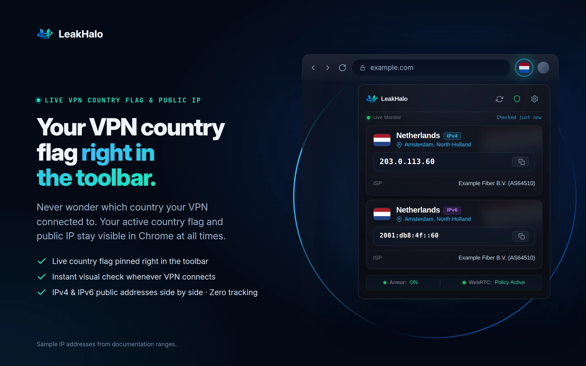
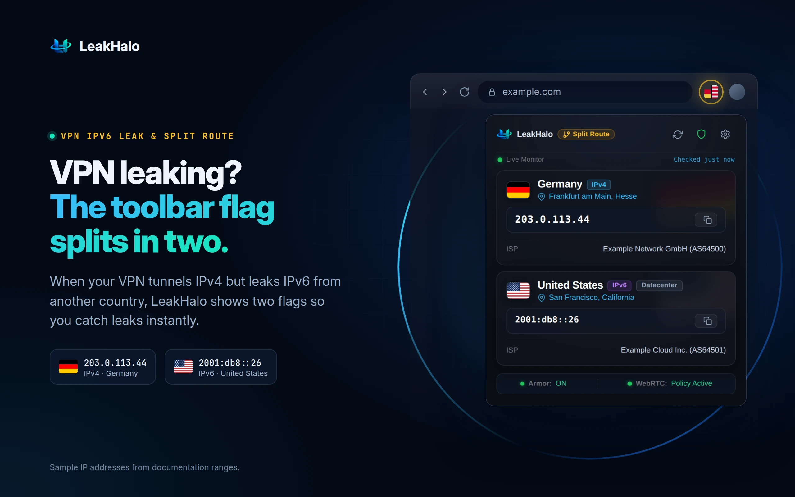
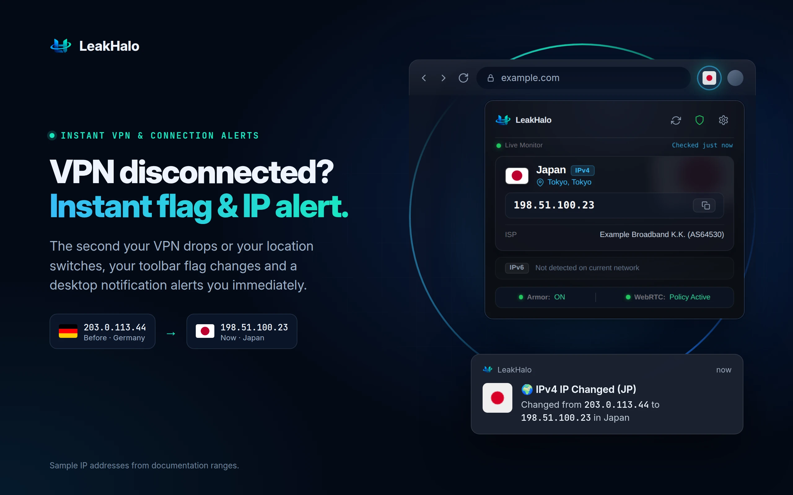
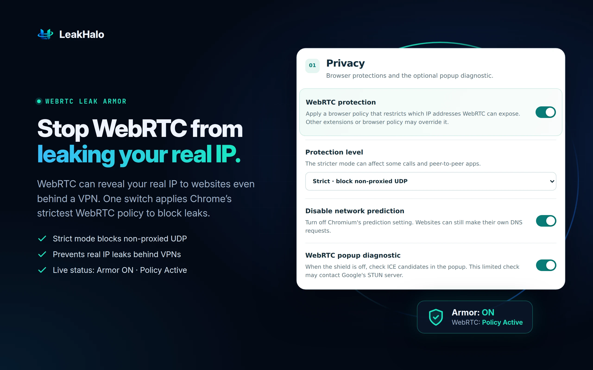
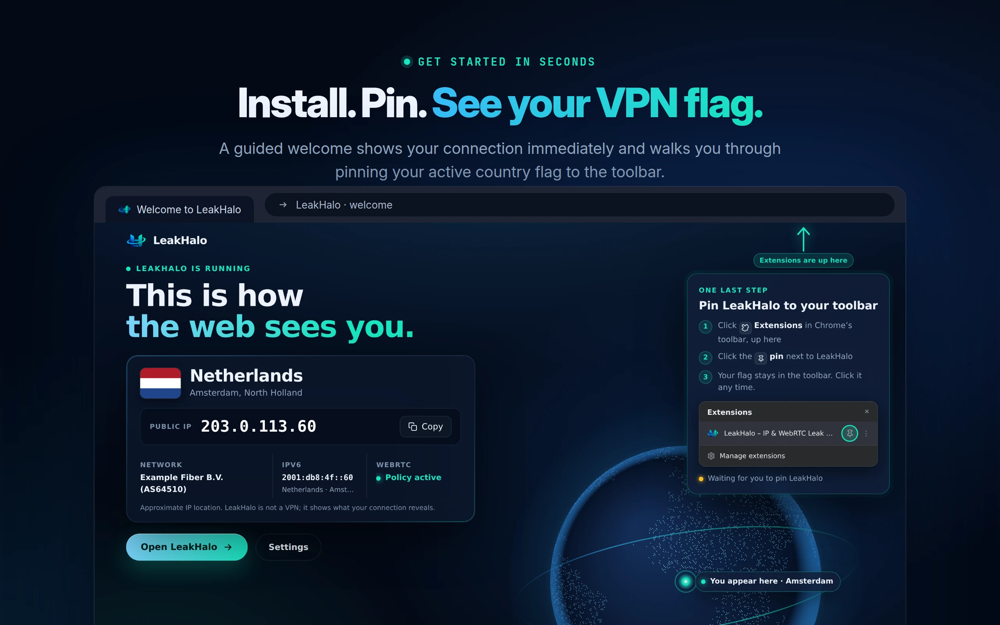

 

### Know your IP. Spot your VPN country. Catch the leaks.

---

**LeakHalo** is a lightweight, zero-telemetry network inspection and privacy tool for Google Chrome. It displays your public IPv4 and IPv6 addresses, identifies your active VPN connection country directly in the toolbar, and seals dangerous WebRTC leaks in a single click.

Whether you are switching VPN locations, working remotely, or verifying your browser privacy, LeakHalo gives you instant clarity about how the web sees your connection.

Zero tracking. Zero telemetry. No account. Built with care by **SLMN LABS**.

## Features

* 🚩 **Live Country Flag in Toolbar:** Instant visual confirmation of where your VPN or connection exits.
* ⚡ **Instant Switch Alerts:** Desktop notification the exact second your connection, IP, or country changes.
* 🛡️ **WebRTC Armor:** Apply Chromium's native strict policy to seal WebRTC leaks behind VPNs.
* 🌐 **IPv4 & IPv6 Side by Side:** Detect Split Routing when a VPN only covers one protocol.
* 👁️ **Screenshot Mask Mode:** Hide addresses with one click for private sharing.
* 🌍 **13 Languages:** Full localized interface and store support.

## Visual Walkthrough

  
    
  
    
  
    
  
    
  

## Privacy & Security

LeakHalo is completely serverless. It contacts public discovery endpoints and caches results only in your browser's local memory. See [PRIVACY.md](PRIVACY.md) or read the online policy at [slmnlabs.github.io/leakhalo/privacy.html](https://slmnlabs.github.io/leakhalo/privacy.html).

## License

MIT License. See [LICENSE](LICENSE) for details.
