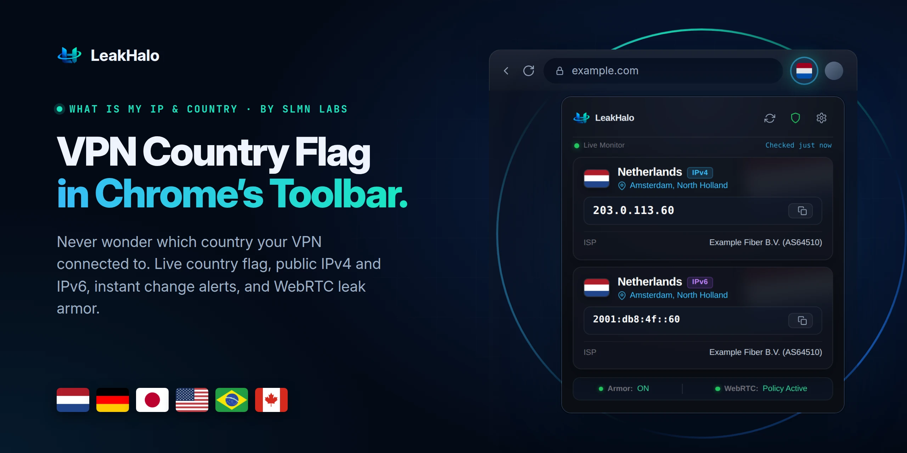

 

### Your public IP, country flag and every leak, one glance away in Chrome’s toolbar.

---

**LeakHalo** shows the public IP address your browser really connects from, where in the world it appears to be, and whether WebRTC could reveal more than you think. A country flag lives right in Chrome's toolbar, and a desktop notification alerts you within seconds whenever your VPN drops or switches countries.

Zero tracking. Zero telemetry. No account. Built with care by **SLMN LABS**.

## Features

* 🚩 **Live Country Flag in Toolbar:** Instant visual confirmation of where your VPN or connection exits.
* ⚡ **Instant Change Alerts:** Desktop notification the exact second your connection or country switches.
* 🛡️ **WebRTC Armor:** Apply Chromium's native policy to seal WebRTC leaks behind VPNs.
* 🌐 **IPv4 & IPv6 Side by Side:** Detect Split Routing when different protocols take different paths.
* 👁️ **Screenshot Mask Mode:** Hide addresses with one click for private sharing.
* 🌍 **13 Languages:** Full localized interface and store support.

## Privacy & Security

LeakHalo is completely serverless. It contacts public discovery endpoints and caches results only in your browser's local memory. See [PRIVACY.md](PRIVACY.md) or read the online policy at [slmnlabs.github.io/leakhalo/privacy.html](https://slmnlabs.github.io/leakhalo/privacy.html).

## License

MIT License. See [LICENSE](LICENSE) for details.
